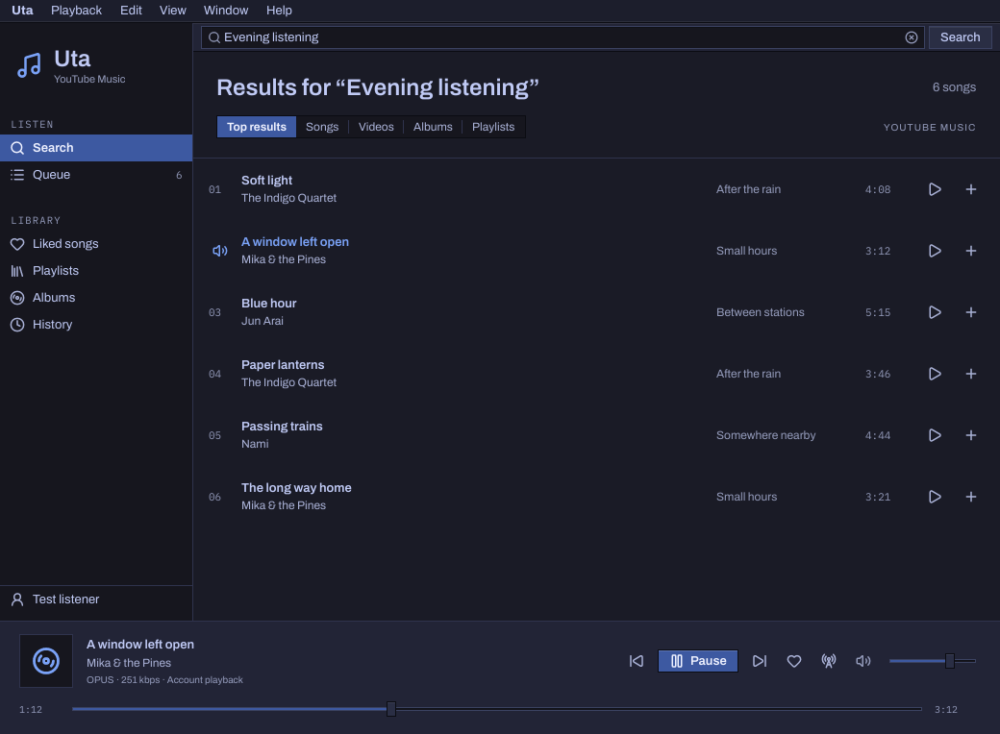

# Uta 歌 — YouTube Music

Uta is a native YouTube Music client for
[Aizome](https://github.com/bitemyapp/aizome),
[Sekka](https://github.com/bitemyapp/sekka)'s desktop environment.
*Uta* means “song.” Its Rust interface uses Aizome's widget kit and
[Sidestep](https://github.com/bitemyapp/sidestep), with native Wayland windows.



This is an early, working client. Search songs, videos, albums, and
playlists; play audio; build a queue; and connect your account to browse your
library.

- Native Day and Night themes, keyboard navigation, global menus, and Aizome's command palette.
- Play/pause, next/previous, seeking, volume, shuffle, and repeat.
- Radio from any song, and a queue you can reorder, with Play Next.
- Queued songs start at once: the next one is looked up while the current
  one plays.
- A saved queue that restores without automatically playing.
- MPRIS integration for desktop media controls and media keys.
- Your liked songs, playlists, albums, and listening history; like and unlike songs.
- YouTube Music links: paste one into search, or pass it to `aizome-uta`.
- One-click account connection from whichever browser you're signed in with,
  without creating API credentials.

## Run

On Linux with Nix flakes:

```sh
nix run github:bitemyapp/uta
```

The package includes the music service dependencies, mpv, Deno, the desktop
entry, and the app icon. It works in Aizome and other Wayland desktops.
For a preview with fictional song metadata and no network or account access:

```sh
nix run github:bitemyapp/uta -- --demo
```

For a NixOS configuration, add Uta as a flake input, import
`uta.nixosModules.default`, and set `programs.uta.enable = true;`.
The executable is `aizome-uta`; the desktop app ID is `org.aizome.Uta`.

## Connect your account

Open **Connect account** in Uta's sidebar. Uta looks through the browsers on
this computer and lists each profile that is signed in to YouTube, most
recently used first; click **Connect** beside one. The browser can stay open.
Opening **Liked songs** before you've connected offers the same thing in one
click.

If no browser is signed in yet, click **Sign in with your browser**.
YouTube Music opens in your default browser, and Uta connects by itself once
the browser has saved the new sign-in. Chromium-based browsers can take up to
half a minute to save it.

Uta finds these browsers, including their Flatpak and Snap installations:

- Firefox, LibreWolf, Zen, Floorp, and Waterfox, with each Firefox container
  listed separately
- Chrome, Chromium, Brave, Edge, Vivaldi, Opera, Helium, Thorium, Yandex,
  Whale, and qutebrowser
- GNOME Web

Chromium-based browsers seal their cookies with a key kept in the desktop
keyring. Uta tries each browser key there, so Chrome and Chromium work in
Aizome, where Sekka gives them the keyring. Your keyring may ask to be
unlocked.

Two other ways cover everything else, including a browser on another
computer:

- **Connect from clipboard.** On music.youtube.com, open the developer tools'
  Network tab, right-click any request to music.youtube.com, and copy it as
  cURL or copy its request headers. Then click the button. A cookies.txt
  export of youtube.com works too.
- **Choose folder…** opens the profile folder of a browser that Uta doesn't
  know, or one kept elsewhere.

A browser signed in to several Google accounts connects the first one. A
request copied from the developer tools connects the account it was made for.
A separate browser profile or Firefox container also works.

A running Secret Service desktop keyring, such as GNOME Keyring, is required
to save the session. Uta retains only YouTube cookies, stored in the desktop
keyring, along with which browser they came from. Both library requests and
audio extraction use the saved session. Cookies are not written to the queue
file, command-line arguments, or application logs. Uta reads a browser only
while finding sign-ins and when you connect. Finding sign-ins looks only at
cookie names and dates.
If YouTube expires the session, **Reconnect** on the Account page brings in
that browser's current sign-in. **Disconnect** stops playback and removes the
saved session.

With a Premium account connected, Uta requests the best available audio using
that session. The player displays the selected codec and bitrate; a connected
account does not guarantee that every song exposes a Premium format. YouTube's
unofficial interfaces and playback requirements change, so the service
dependencies occasionally need updating. Premium offline downloads and
gapless playback are not implemented.

## Keyboard

| Shortcut | Action |
| --- | --- |
| Super+F | Search |
| Enter in search | Run search |
| Enter on a selected song | Play |
| Super+P | Play/pause |
| Super+Left / Right | Previous / next |
| Super+. | Stop |
| Super+1 / 2 / 3 | Liked songs / playlists / queue |
| Super+, | Account |
| Super+R | Refresh |
| Super+Q | Quit |

Right-click a song for Play Next, Start Radio, Like, Copy Song Link, and, in
the queue, Move Up and Move Down. Albums, History, Start Radio, and the
selected song's actions are in the menus, and so in Aizome's command palette.

Search starts with YouTube Music's top results, songs and videos (mixes and
uploads are videos, not catalog songs). The Songs, Videos, Albums, and
Playlists tabs fetch up to 40 matches each, and library playlists and albums
up to 100 each. Song lists hold up to 1,000 tracks, and radio fetches about 50. Search
pagination, playlist editing, and uploads are not yet implemented. The queue
can hold up to 5,000 songs.

## Develop and test

`nix build` assembles the pinned Aizome and Sidestep sources automatically.
For Cargo development, the repositories sit beside one another:

```text
work/
  uta/
  aizome/                 # 729cf1c140b349dc6f8a9d7ba1772c4b9bb4fe18
  sidestep-aizome/        # 16a1e376c0bd85d52ef020e114bbd1707fb9b14b
```

Aizome's `sidestep` link points to `../sidestep-aizome`. These revisions are
also recorded in `flake.nix` and `flake.lock`. Existing checkouts can be used
for toolkit development; the package always builds against the locked inputs.

```sh
nix develop
cargo run -- --demo
cargo test
python3 -m unittest discover -s service/tests -v
cargo clippy --all-targets -- -D warnings
cargo fmt --check -p aizome-uta
nix build
```

The tests exercise native widgets, screenshots in both themes, playback races,
queue persistence, browser discovery and cookie decryption against synthetic
Firefox and Chromium profiles, cookie filtering, authenticated extraction,
actual mpv playback through a silent output, and MPRIS on a private D-Bus
session. They do not read your browser session or contact YouTube. Golden tests require
Aizome's fonts, which `nix develop` supplies. To deliberately update them:

```sh
AIZOME_UPDATE_GOLDENS=1 cargo test --test app native_views_in_both_themes
```

Optional checks against public YouTube content, without account access:

```sh
python3 scripts/smoke-service
cargo test --test network -- --ignored --nocapture
```

See [architecture](docs/architecture.md) for the service boundary and
[performance](docs/performance.md) for the frame-budget measurement.
[YouTube integration research](docs/youtube-integration-research.md) compares
native service options, records playback experiments, and includes a RustyPipe
evaluation handoff. The app icon is drawn by `data/genicon.py` in Aizome's icon
grammar; change the
script and run `python3 data/genicon.py data` rather than editing the SVG.

## License

MIT OR Apache-2.0, matching Aizome. See [LICENSE-MIT](LICENSE-MIT) and
[LICENSE-APACHE](LICENSE-APACHE).
